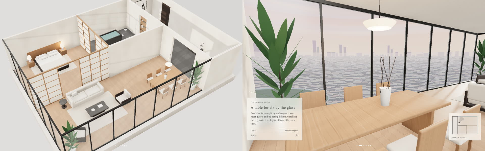

# threshold

The aman.com home page, rebuilt, with one thing added: before booking, you can walk through the suite.

Pick Aman Tokyo, Amangiri or Amanpuri and scroll. The camera flies in from the skyline, the desert or the sea, the suite appears as a white architect's model, colours itself in, and then you walk through it room by room, with a note in each room and a small plan in the corner showing where you are. Scroll back up and all of it plays in reverse.

This is an unofficial concept. I have no connection to Aman. Their name, logo and photographs load from aman.com and belong to them; the suites are my own invention, loosely based on what each property is known for.



## Why

Luxury hotel sites sell rooms with photographs, and photographs are good at mood and bad at space. You cannot tell from six pictures whether the bath is in the bedroom, how far the bed is from the window, or what you see from the sofa. A floor plan answers that, but nobody reads floor plans.

A walk-through answers it without asking anyone to read anything. The reference I worked from was a property-developer site that does it with pre-rendered video. I wanted to see whether it could be done live in the browser instead, from a plan written as data, so that adding a suite means writing a file rather than commissioning a film.

## How it works

Each suite is one TypeScript file in `src/suites/`: rooms as rectangles, walls as segments with their doors and windows, furniture by kind and position, and the stops of the walk with what to say at each. Three things read that file:

- `tour/build.ts` turns it into a three.js scene. Walls are split around their openings, floors and walls get world-space UVs so grain stays the same size everywhere, and furniture comes from a small parametric kit (`tour/furniture.ts`).
- The camera path is a Catmull-Rom curve through the stops.
- The minimap is drawn as SVG from the same rooms and walls.

There are no texture files. Wood, stone, plaster, washi and the view out of the window are painted on canvases when the page loads (`tour/materials.ts`, `tour/views.ts`). The white maquette is not a second set of materials: one shader uniform blends every surface between clay and its finish, so the colour-in is a single tween.

Scrolling drives one GSAP timeline through ScrollTrigger. The timeline never touches three.js; it writes numbers into a plain object (how far along the flight, how much clay, which note is showing) and the render loop reads them each frame. N8AO adds contact shadows indoors, which did more for realism than anything else I tried.

`src/tour/walk.test.ts` checks that no walk passes through a wall. It caught three of them while I was writing the suites.

## Running it

```sh
pnpm install
pnpm dev        # http://localhost:5173
pnpm test
pnpm lint
pnpm build      # typecheck, then build to dist/
```

Node 24. Set `BASE=/threshold/` when building for GitHub Pages; the Pages workflow does it for you.

## Adding a suite

Copy one of the files in `src/suites/`, change the plan, and register it in `src/main.ts` with a button in the picker in `index.html`. Run the tests: they will tell you if the walk goes through a wall, if a stop is off the plan, or if you used a finish you never defined. Then look at it, because the tests cannot tell you whether it is any good.

## Trade-offs

- **Live 3D instead of video.** Lighter (about 300 kB of compressed JavaScript, fetched only when you scroll near it, instead of tens of megabytes of frames), sharp on any screen, reversible and responsive to the pointer. The price is realism: a rendered film still looks better. See [ADR 1](docs/adr/0001-live-3d-not-frames.md).
- **The view outside is flat.** It is a painted cylinder. From inside a room you cannot tell; from the doorway of a terrace you sometimes can.
- **Fonts.** Aman's Lyon and Whitney are licensed, so Spectral and Hanken Grotesk stand in.
- **The hero film.** Aman's Vimeo film only plays on aman.com, so a still of the same resort drifts in its place.

## What I would do with a real client

The plan files would come from the architects' drawings rather than from me, and the furniture from their glTF models instead of rounded boxes. For the view out of the window I would shoot a 360° panorama from the actual suite. Beyond that, Gaussian splats captured on site would close most of the gap with video while keeping everything that makes it worth doing live. Copy would move into the CMS that already runs the rest of the site, and I would set a frame-time budget for mid-range Android phones and hold the scene to it in CI.

## Licence

MIT for the code. Nothing here grants any right to Aman's name, logo or photographs.
